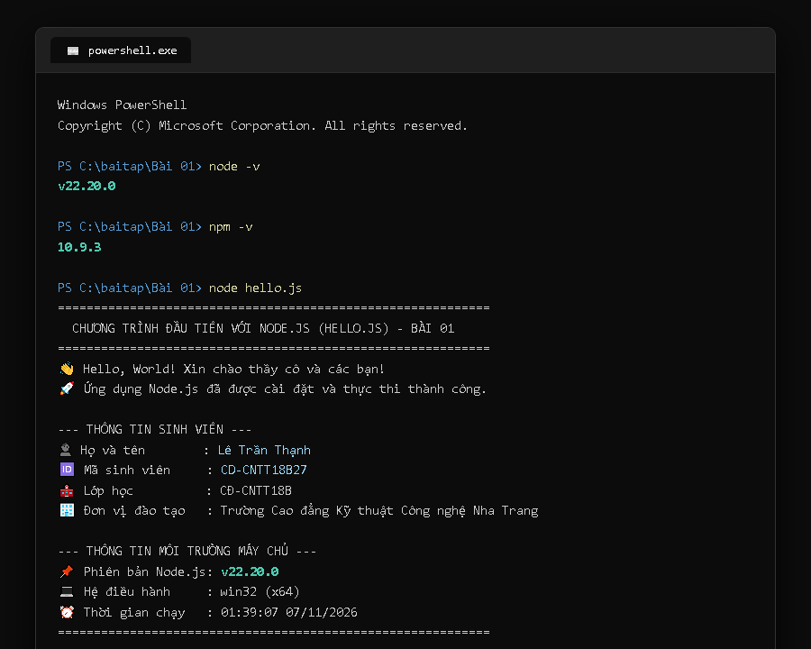

# BÀI TẬP 01: CÀI ĐẶT NODE.JS LTS & CHƯƠNG TRÌNH HELLO.JS

## 📌 Yêu cầu đề bài
> **Yêu cầu:** Cài Node.js LTS; chạy `node -v` và `npm -v`; tạo một file `hello.js` và mô tả kết quả. Nộp liên kết repository GitHub hoặc ghi chú minh chứng.

---

## 👨‍🎓 Thông tin sinh viên
* **Họ và tên:** Lê Trần Thạnh
* **Mã sinh viên (MSSV):** CD-CNTT18B27
* **Lớp:** CĐ-CNTT18B
* **Khoa / Trường:** Khoa Điện - Điện tử / Trường Cao đẳng Kỹ thuật Công nghệ Nha Trang
* **Repository GitHub:** [https://github.com/Billmtp/Node.js](https://github.com/Billmtp/Node.js)
* **Liên kết thư mục Bài 01:** [https://github.com/Billmtp/Node.js/tree/main/Bài%2001](https://github.com/Billmtp/Node.js/tree/main/Bài%2001)

---

## 🛠️ Cấu trúc thư mục
```
Bài 01/
├── hello.js         # Chương trình JavaScript đầu tiên chạy trên nền tảng Node.js
├── package.json     # File cấu hình thông tin dự án và script npm
├── screenshot.png   # Ảnh chụp minh chứng chạy node -v, npm -v và node hello.js
└── README.md        # Hướng dẫn chi tiết, mô tả kết quả và ghi chú minh chứng
```

---

## 🚀 Các bước thực hiện

### 1. Cài đặt Node.js LTS
* Tải bộ cài đặt Node.js LTS từ trang chủ chính thức: [https://nodejs.org/](https://nodejs.org/)
* Tiến hành cài đặt theo các bước mặc định trên hệ điều hành Windows.

### 2. Kiểm tra phiên bản Node.js và npm
Mở Terminal / PowerShell và thực thi các câu lệnh:

* **Kiểm tra phiên bản Node.js:**
  ```powershell
  node -v
  ```
  *Kết quả trả về:* `v22.20.0` (Phiên bản Node.js 22 LTS)

* **Kiểm tra phiên bản trình quản lý gói npm:**
  ```powershell
  npm -v
  ```
  *Kết quả trả về:* `10.9.3`

---

### 3. Tạo file `hello.js` và thực thi chương trình

#### Cách 1: Chạy trực tiếp bằng Node.js
```powershell
cd "Bài 01"
node hello.js
```

#### Cách 2: Chạy thông qua npm script
```powershell
npm start
```

---

## 📊 Mô tả kết quả thực thi
Khi thực thi file `hello.js`, môi trường Node.js biên dịch và xuất ra màn hình console:

```text
============================================================
  CHƯƠNG TRÌNH ĐẦU TIÊN VỚI NODE.JS (HELLO.JS) - BÀI 01
============================================================
👋 Hello, World! Xin chào thầy cô và các bạn!
🚀 Ứng dụng Node.js đã được cài đặt và thực thi thành công.

--- THÔNG TIN SINH VIÊN ---
👤 Họ và tên        : Lê Trần Thạnh
🆔 Mã sinh viên     : CD-CNTT18B27
🏫 Lớp học          : CĐ-CNTT18B
🏢 Đơn vị đào tạo   : Trường Cao đẳng Kỹ thuật Công nghệ Nha Trang

--- THÔNG TIN MÔI TRƯỜNG MÁY CHỦ ---
📌 Phiên bản Node.js: v22.20.0
💻 Hệ điều hành     : win32 (x64)
⏰ Thời gian chạy   : 01:38:53 7/11/2026
============================================================
```

### Giải thích hoạt động của mã nguồn:
1. `console.log()`: Hàm chuẩn của JavaScript/Node.js để xuất dữ liệu ra luồng đầu ra tiêu chuẩn (`stdout`).
2. `process.version`: Thuộc tính tích hợp sẵn của Node.js cung cấp chuỗi phiên bản Node.js hiện thời (`v22.20.0`).
3. `process.platform` & `process.arch`: Trả về tên hệ điều hành (`win32`) và kiến trúc vi xử lý (`x64`).
4. `new Date().toLocaleString('vi-VN')`: Hiển thị ngày giờ thực thi theo định dạng chuẩn tiếng Việt.

---

## 📸 Hình ảnh minh chứng kết quả chạy thực tế

Ảnh chụp màn hình thực tế trong PowerShell khi chạy `node -v`, `npm -v` và chạy chương trình `node hello.js`:



---

## 📝 Ghi chú minh chứng bài làm
* **Môi trường:** Đã cài đặt thành công Node.js phiên bản LTS `v22.20.0` và npm `10.9.3`.
* **Chương trình:** File `hello.js` hoạt động chính xác, không phát sinh lỗi cú pháp, hiển thị đầy đủ thông tin sinh viên và hệ thống.
* **Mã nguồn:** Toàn bộ thư mục đã được lưu trữ và đồng bộ lên GitHub Repository [https://github.com/Billmtp/Node.js](https://github.com/Billmtp/Node.js).
