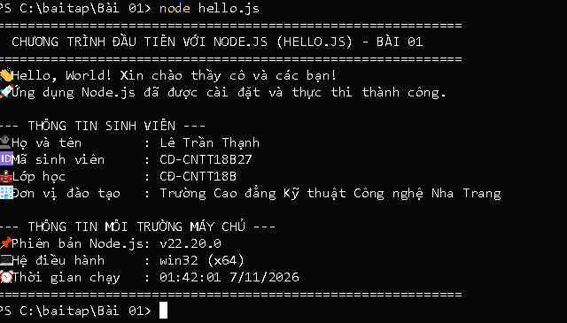

# BÀI TẬP 01: CÀI ĐẶT NODE.JS LTS & CHƯƠNG TRÌNH HELLO.JS

## 📌 Yêu cầu đề bài
> **Yêu cầu:** Cài Node.js LTS; chạy `node -v` và `npm -v`; tạo một file `hello.js` và mô tả kết quả. Nộp liên kết repository GitHub hoặc ghi chú minh chứng.

---

## 👨‍🎓 Thông tin sinh viên
* **Họ và tên:** Lê Trần Thạnh
* **Mã sinh viên (MSSV):** CD-CNTT18B27
* **Lớp:** CĐ-CNTT18B
* **Khoa / Trường:** Khoa Điện - Điện tử / Trường Cao đẳng Kỹ thuật Công nghệ Nha Trang
* **Repository GitHub:** [https://github.com/Billmtp/Node.js](https://github.com/Billmtp/Node.js)

---

## 🛠️ Cấu trúc thư mục
```
Bài 01/
├── hello.js          # Chương trình JavaScript đầu tiên
├── package.json      # File cấu hình và npm script
├── step1_cd.png      # Ảnh chụp thực tế lệnh di chuyển thư mục cd
├── step2_node_v.png  # Ảnh chụp thực tế kiểm tra phiên bản node -v
├── step3_npm_v.png   # Ảnh chụp thực tế kiểm tra phiên bản npm -v
├── step4_run.png     # Ảnh chụp thực tế chạy node hello.js và kết quả
└── README.md         # Mô tả các bước và kết quả thực hiện
```

---

## 🚀 Các bước thực hiện & Minh chứng ảnh chụp thực tế từng bước

### Bước 1: Mở PowerShell và di chuyển vào thư mục bài tập
```powershell
cd "c:\baitap\Bài 01"
```


---

### Bước 2: Kiểm tra phiên bản Node.js
```powershell
node -v
```


---

### Bước 3: Kiểm tra phiên bản npm
```powershell
npm -v
```


---

### Bước 4: Thực thi chương trình `hello.js`
```powershell
node hello.js
```


---

## 📝 Giải thích hoạt động mã nguồn & Kết quả
1. `console.log()`: Xuất dữ liệu chuỗi chào mừng và thông tin sinh viên ra màn hình Terminal.
2. `process.version`: Lấy phiên bản Node.js đang chạy (`v22.20.0`).
3. `process.platform` & `process.arch`: Lấy thông tin hệ điều hành (`win32`) và kiến trúc CPU (`x64`).
4. `new Date().toLocaleString('vi-VN')`: Hiển thị ngày giờ chạy chương trình theo chuẩn tiếng Việt.
