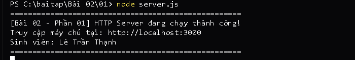

# BÀI TẬP 02 - PHẦN 01: HTTP SERVER BẰNG NODE.JS THUẦN

## 📌 Yêu cầu đề bài
> **Yêu cầu 1:** Tạo HTTP server bằng Node.js thuần; truy cập `localhost:3000` và trả về trang HTML chứa tên sinh viên. Đẩy mã nguồn lên GitHub.

---

## 👨‍🎓 Thông tin sinh viên
* **Họ và tên:** Lê Trần Thạnh
* **Mã sinh viên (MSSV):** CD-CNTT18B27
* **Lớp:** CĐ-CNTT18B
* **Khoa / Trường:** Khoa Điện - Điện tử / Trường Cao đẳng Kỹ thuật Công nghệ Nha Trang
* **Repository GitHub:** [https://github.com/Billmtp/Node.js](https://github.com/Billmtp/Node.js)

---

## 🛠️ Cấu trúc thư mục
```
Bài 02/01/
├── server.js        # Mã nguồn HTTP Server bằng Node.js thuần (module http)
├── package.json     # File cấu hình và script npm
├── step1_cd.png     # Ảnh chụp thực tế lệnh cd
├── step2_run.png    # Ảnh chụp thực tế lệnh node server.js
├── screenshot.png   # Ảnh chụp thực tế giao diện trình duyệt tại localhost:3000
└── README.md        # Hướng dẫn chi tiết cách chạy và minh chứng
```

---

## 🚀 Các bước thực hiện & Minh chứng ảnh chụp thực tế từng bước

### Bước 1: Mở PowerShell và di chuyển vào thư mục bài tập
```powershell
cd "c:\baitap\Bài 02\01"
```


---

### Bước 2: Khởi động máy chủ HTTP
```powershell
node server.js
```
*(Hoặc dùng lệnh `npm start`)*



---

### Bước 3: Mở trình duyệt web kiểm tra kết quả
Truy cập địa chỉ: [http://localhost:3000](http://localhost:3000)


---

## 🔍 Giải thích mã nguồn (`server.js`)
* **Module http tích hợp:** `const http = require('http');` — Sử dụng module có sẵn trong Node.js, không cần thư viện ngoài.
* **Thiết lập Header UTF-8:** `res.writeHead(200, { 'Content-Type': 'text/html; charset=utf-8' });` — Trả về định dạng HTML và hiển thị đúng tiếng Việt có dấu.
* **Lắng nghe cổng:** `server.listen(3000, 'localhost', ...)` — Kích hoạt server lắng nghe tại cổng 3000.
