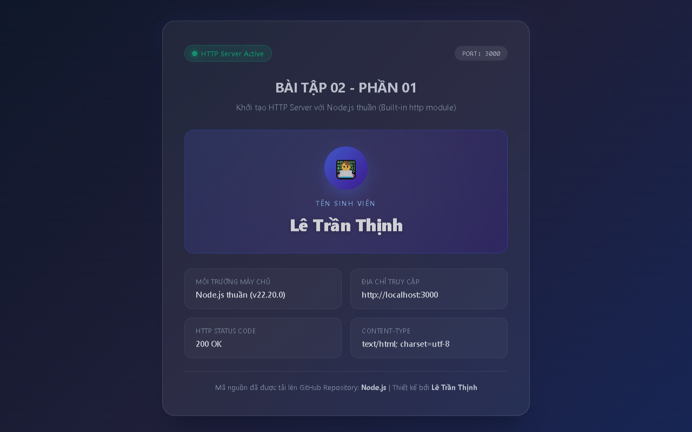

# BÀI TẬP 02 - PHẦN 01: HTTP SERVER BẰNG NODE.JS THUẦN

## 📌 Yêu cầu đề bài
> **Yêu cầu 1:** Tạo HTTP server bằng Node.js thuần; truy cập `localhost:3000` và trả về trang HTML chứa tên sinh viên. Đẩy mã nguồn lên GitHub.

---

## 👨‍🎓 Thông tin sinh viên
* **Họ và tên:** Lê Trần Thịnh
* **Mã sinh viên (MSSV):** CD-CNTT18B27
* **Lớp:** CĐ-CNTT18B
* **Khoa / Trường:** Khoa Điện - Điện tử / Trường Cao đẳng Kỹ thuật Công nghệ Nha Trang
* **Repository GitHub:** [https://github.com/Billmtp/Node.js](https://github.com/Billmtp/Node.js)

---

## 🛠️ Cấu trúc thư mục
```
Bài 02/01/
├── server.js        # Mã nguồn HTTP Server bằng Node.js thuần (module http)
├── package.json     # File cấu hình và script khởi chạy ứng dụng
├── screenshot.png   # Ảnh chụp màn hình kết quả chạy thực tế tại localhost:3000
└── README.md        # Hướng dẫn chi tiết cách chạy code và giải thích
```

---

## 🚀 Hướng dẫn cách chạy mã nguồn

### 1. Yêu cầu môi trường
* Đã cài đặt **Node.js** (khuyến nghị phiên bản 18+ hoặc 20+ LTS).
* Trình duyệt web bất kỳ (Chrome, Edge, Firefox, Brave,...).

### 2. Các bước thực hiện

#### Bước 1: Mở Terminal / PowerShell và di chuyển vào thư mục bài tập
```powershell
cd "Bài 02/01"
```

#### Bước 2: Khởi động máy chủ HTTP
Bạn có thể sử dụng 1 trong 2 cách sau:

* **Cách 1 (Sử dụng Node.js trực tiếp):**
  ```powershell
  node server.js
  ```

* **Cách 2 (Sử dụng script npm):**
  ```powershell
  npm start
  ```

Khi khởi động thành công, màn hình console sẽ hiển thị thông báo:
```text
====================================================
[Bài 02 - Phần 01] HTTP Server đang chạy thành công!
Truy cập máy chủ tại: http://localhost:3000
Sinh viên: Lê Trần Thịnh
====================================================
```

#### Bước 3: Mở trình duyệt web để kiểm tra kết quả
* Mở trình duyệt và truy cập vào đường dẫn:
  ```
  http://localhost:3000
  ```
* Trang web sẽ hiển thị thông tin tên sinh viên **Lê Trần Thịnh** cùng thông số máy chủ HTTP.

---

## 📸 Hình ảnh minh chứng thực tế (Ảnh chụp thật khi chạy localhost:3000)

Dưới đây là ảnh chụp màn hình thực tế khi server đang chạy và được truy cập tại cổng `3000`:



---

## 🔍 Giải thích mã nguồn (`server.js`)
* **Khởi tạo module:** `const http = require('http');` — Sử dụng module `http` tích hợp sẵn trong Node.js (không phụ thuộc vào thư viện ngoài như Express, Koa).
* **Thiết lập Header:** `res.writeHead(200, { 'Content-Type': 'text/html; charset=utf-8' });` — Đảm bảo máy khách nhận diện trang là định dạng HTML và mã hóa tiếng Việt có dấu chuẩn UTF-8.
* **Giao diện HTML:** Được thiết kế hiện đại, tương thích tốt trên cả máy tính lẫn thiết bị di động, hiển thị rõ ràng thông tin sinh viên và trạng thái hoạt động của máy chủ.
* **Lắng nghe cổng:** `server.listen(3000, 'localhost', ...)` — Kích hoạt server lắng nghe kết nối tại cổng 3000.
