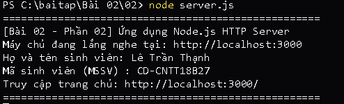

# BÀI TẬP 02 - PHẦN 02: ỨNG DỤNG NODE.JS SỬ DỤNG MODULE HTTP

## 📌 Yêu cầu đề bài
> **Yêu cầu 2:** Tạo ứng dụng Node.js sử dụng module `http`. Server chạy tại cổng `3000`. Khi truy cập trang chủ, trả về HTML có họ tên và mã sinh viên. Nộp liên kết GitHub và mô tả cách chạy.

---

## 👨‍🎓 Thông tin sinh viên
* **Họ và tên:** Lê Trần Thạnh
* **Mã sinh viên (MSSV):** CD-CNTT18B27
* **Lớp:** CĐ-CNTT18B
* **Khoa / Trường:** Khoa Điện - Điện tử / Trường Cao đẳng Kỹ thuật Công nghệ Nha Trang
* **Repository GitHub:** [https://github.com/Billmtp/Node.js](https://github.com/Billmtp/Node.js)

---

## 🛠️ Cấu trúc thư mục
```
Bài 02/02/
├── server.js        # Ứng dụng Node.js sử dụng module http tích hợp
├── package.json     # Cấu hình dự án và npm script
├── step1_cd.png     # Ảnh chụp thực tế lệnh cd
├── step2_run.png    # Ảnh chụp thực tế lệnh node server.js
├── screenshot.png   # Ảnh chụp thực tế giao diện trình duyệt tại localhost:3000
└── README.md        # Hướng dẫn chi tiết cách chạy và minh chứng
```

---

## 🚀 Các bước thực hiện & Minh chứng ảnh chụp thực tế từng bước

### Bước 1: Mở PowerShell và di chuyển vào thư mục bài tập
```powershell
cd "c:\baitap\Bài 02\02"
```


---

### Bước 2: Khởi chạy máy chủ HTTP Node.js
```powershell
node server.js
```
*(Hoặc dùng lệnh `npm start`)*



---

### Bước 3: Mở trình duyệt web truy cập trang chủ
Truy cập địa chỉ: [http://localhost:3000/](http://localhost:3000/)


---

## 🔍 Giải thích giải pháp kỹ thuật (`server.js`)
1. **Module `http`:** Khởi tạo qua `const http = require('http');` để tạo máy chủ HTTP mà không cần thư viện ngoài.
2. **Định tuyến (Routing):** Phân tích `req.url` để kiểm tra route trang chủ (`/`), trả về mã trạng thái 200 và giao diện HTML chứa thông tin sinh viên; các route khác trả về mã 404.
3. **Mã hóa tiếng Việt:** Thiết lập header `Content-Type: text/html; charset=utf-8` hiển thị chuẩn tiếng Việt có dấu.
