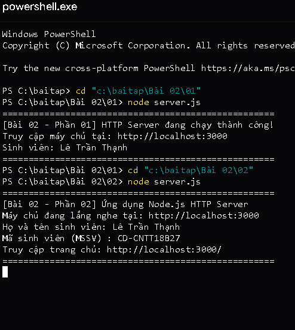
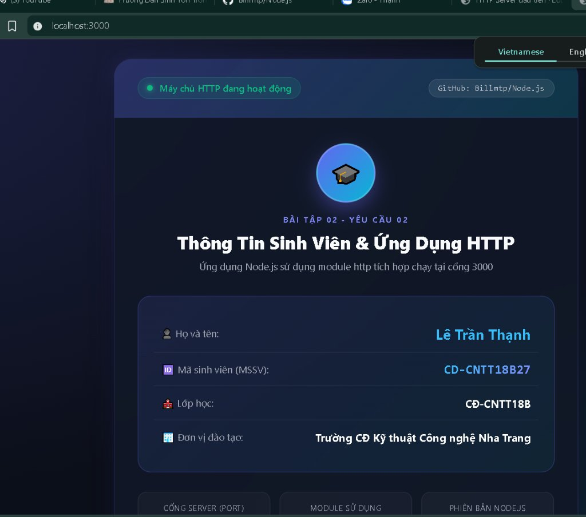

# BÀI TẬP 02 - PHẦN 02: ỨNG DỤNG NODE.JS SỬ DỤNG MODULE HTTP

## 📌 Yêu cầu đề bài
> **Yêu cầu 2:** Tạo ứng dụng Node.js sử dụng module `http`. Server chạy tại cổng `3000`. Khi truy cập trang chủ, trả về HTML có họ tên và mã sinh viên. Nộp liên kết GitHub và mô tả cách chạy.

---

## 👨‍🎓 Thông tin sinh viên & Báo cáo bài nộp
* **Họ và tên:** Lê Trần Thạnh
* **Mã sinh viên (MSSV):** CD-CNTT18B27
* **Lớp:** CĐ-CNTT18B
* **Khoa / Trường:** Khoa Điện - Điện tử / Trường Cao đẳng Kỹ thuật Công nghệ Nha Trang
* **Liên kết Repository GitHub:** [https://github.com/Billmtp/Node.js](https://github.com/Billmtp/Node.js)
* **Liên kết trực tiếp tới thư mục Bài 02/02:** [https://github.com/Billmtp/Node.js/tree/main/Bài%2002/02](https://github.com/Billmtp/Node.js/tree/main/Bài%2002/02)

---

## 🛠️ Cấu trúc thư mục
```
Bài 02/02/
├── server.js        # Ứng dụng Node.js sử dụng module http tích hợp
├── package.json     # Thông tin ứng dụng và scripts khởi chạy
├── screenshot.png   # Ảnh chụp màn hình thật chứng minh ứng dụng chạy thành công
└── README.md        # Tài liệu hướng dẫn cách chạy, liên kết GitHub và giải thích chi tiết
```

---

## 🚀 Hướng dẫn chi tiết cách chạy ứng dụng

### 1. Yêu cầu chuẩn bị
* Máy tính đã cài đặt môi trường **Node.js** (khuyến nghị phiên bản 18+ hoặc 20+ LTS).
* Kiểm tra phiên bản Node.js bằng lệnh:
  ```powershell
  node -v
  ```

### 2. Các bước chạy ứng dụng

#### Bước 1: Mở Terminal / PowerShell và chuyển vào thư mục bài tập
```powershell
cd "Bài 02/02"
```

#### Bước 2: Khởi chạy máy chủ HTTP Node.js
Bạn có thể khởi chạy bằng 1 trong 2 lệnh sau:

* **Sử dụng lệnh Node trực tiếp:**
  ```powershell
  node server.js
  ```
* **Hoặc sử dụng npm script:**
  ```powershell
  npm start
  ```

Khi khởi chạy thành công, console sẽ in ra log chi tiết:
```text
====================================================
[Bài 02 - Phần 02] Ứng dụng Node.js HTTP Server
Máy chủ đang lắng nghe tại: http://localhost:3000
Họ và tên sinh viên: Lê Trần Thạnh
Mã sinh viên (MSSV) : CD-CNTT18B27
Truy cập trang chủ: http://localhost:3000/
====================================================
```

#### Bước 3: Truy cập trang chủ trên trình duyệt
* Mở trình duyệt web bất kỳ (Chrome, Edge, Firefox, Brave,...).
* Nhập địa chỉ:
  ```
  http://localhost:3000/
  ```
* Trang chủ sẽ hiển thị giao diện hồ sơ sinh viên với đầy đủ:
  - **Họ và tên:** Lê Trần Thạnh
  - **Mã sinh viên:** CD-CNTT18B27
  - **Lớp:** CĐ-CNTT18B
  - **Đơn vị đào tạo:** Trường CĐ Kỹ thuật Công nghệ Nha Trang
  - Trạng thái hoạt động của server và liên kết tới repo GitHub.

---

## 📸 Hình ảnh minh chứng thực tế (Ảnh chụp thật khi chạy localhost:3000)

### 1. Khởi chạy máy chủ trên Terminal / PowerShell


### 2. Kết quả hiển thị trang chủ trên trình duyệt (localhost:3000)


---

## 🔍 Mô tả và giải thích giải pháp kỹ thuật (`server.js`)
1. **Module `http`:**
   Ứng dụng sử dụng module tích hợp chuẩn `http` của Node.js qua câu lệnh `const http = require('http');`. Không yêu cầu cài đặt bất kỳ dependency bên ngoài nào.
2. **Khởi tạo máy chủ & Routing trang chủ:**
   - Sử dụng `http.createServer((req, res) => { ... })`.
   - Phân tích `pathname` từ URL: Nếu truy cập trang chủ (`/` hoặc `/index.html`), server trả về mã trạng thái HTTP 200 cùng giao diện HTML đầy đủ họ tên và mã sinh viên.
   - Thiết lập header `res.writeHead(200, { 'Content-Type': 'text/html; charset=utf-8' })` để hỗ trợ hiển thị hoàn hảo tiếng Việt có dấu.
   - Với các route khác, server tự động trả về trang thông báo lỗi 404 thân thiện và hướng dẫn người dùng quay lại trang chủ.
3. **Lắng nghe cổng 3000:**
   `server.listen(3000, 'localhost', ...)` giúp máy chủ sẵn sàng đón nhận các yêu cầu HTTP tại cổng 3000.
