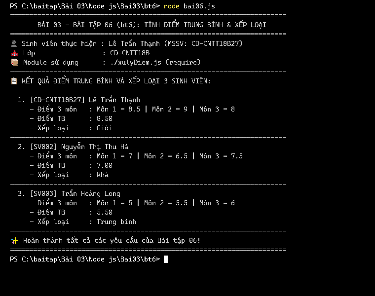

# BÀI 03 (BT6) — BÀI 6. XÂY DỰNG MODULE TÍNH KẾT QUẢ HỌC TẬP

## 📌 Yêu cầu đề bài
> **Yêu cầu:** Tạo hai tập tin `bai06.js` và `xulyDiem.js`:
> - Trong `xulyDiem.js`, xây dựng các hàm tính điểm trung bình của 3 môn và xếp loại học tập: Giỏi (từ 8), Khá (từ 6.5), Trung bình (từ 5), Yếu (dưới 5).
> - Xuất các hàm bằng `module.exports`.
> - Trong `bai06.js`, sử dụng `require()` để gọi các hàm.
> - Tạo dữ liệu 3 sinh viên, hiển thị họ tên, điểm trung bình và xếp loại trên Terminal.
> - Lệnh chạy: `node bai06.js`

---

## 👨‍🎓 Thông tin sinh viên
* **Họ và tên:** Lê Trần Thạnh
* **Mã sinh viên (MSSV):** CD-CNTT18B27
* **Lớp:** CĐ-CNTT18B
* **Trường:** Trường Cao đẳng Kỹ thuật Công nghệ Nha Trang
* **Repository GitHub:** [https://github.com/Billmtp/Node.js](https://github.com/Billmtp/Node.js)

---

## 🛠️ Cấu trúc thư mục
```
Bài 03 - Module, File System và cơ sở dữ liệu/bt6/
├── xulyDiem.js      # Module chứa các hàm tính điểm trung bình và xếp loại
├── bai06.js         # Tập tin chính require module và hiển thị kết quả 3 sinh viên
├── package.json     # Cấu hình dự án và npm script
├── step1_cd.png     # Ảnh chụp thực tế lệnh cd
├── step2_run.png    # Ảnh chụp thực tế chạy node bai06.js và kết quả
└── README.md        # Hướng dẫn chi tiết cách chạy và minh chứng
```

---

## 🚀 Các bước thực hiện & Minh chứng ảnh chụp thực tế từng bước

### Bước 1: Mở PowerShell và di chuyển vào thư mục bài tập
```powershell
cd "c:\baitap\Bài 03\Node js\Bai03\bt6"
```


---

### Bước 2: Chạy chương trình tính điểm và xếp loại
```powershell
node bai06.js
```
*(Hoặc dùng lệnh `npm start`)*



---

## 🔍 Giải thích các thao tác kỹ thuật
1. **Module hóa (`xulyDiem.js`):**
   * Hàm `tinhDiemTrungBinh(m1, m2, m3)` tính trung bình cộng 3 môn và làm tròn 2 chữ số thập phân bằng `toFixed(2)`.
   * Hàm `xepLoaiHocTap(dtb)` phân loại học lực theo các mốc: Giỏi ($\ge 8.0$), Khá ($\ge 6.5$), Trung bình ($\ge 5.0$) và Yếu ($< 5.0$).
   * Xuất các hàm qua cơ chế `module.exports = { tinhDiemTrungBinh, xepLoaiHocTap };`.
2. **Gọi Module (`bai06.js`):**
   * Sử dụng cú pháp destructuring: `const { tinhDiemTrungBinh, xepLoaiHocTap } = require('./xulyDiem');` để nạp các hàm cần dùng.
   * Duyệt danh sách 3 sinh viên, gọi hàm xử lý và hiển thị thông tin chi tiết bằng `console.log()`.