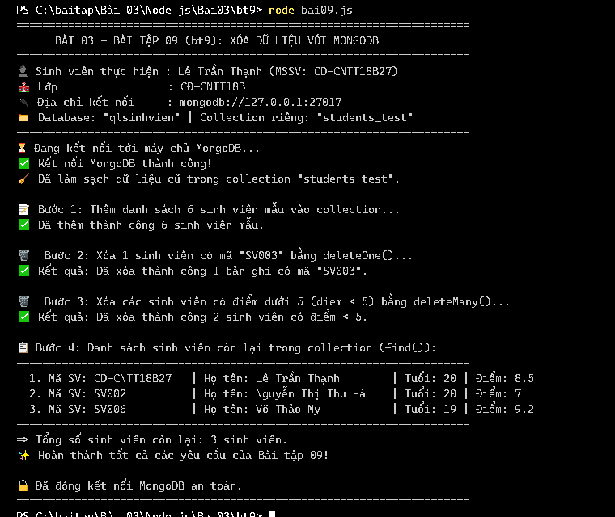

# BÀI 03 (BT9) — BÀI 9. XÓA DỮ LIỆU CÓ ĐIỀU KIỆN TRONG MONGODB

## 📌 Yêu cầu đề bài
> **Yêu cầu:** Tạo tập tin `bai09.js`:
> - Kết nối database `qlsinhvien`, sử dụng collection riêng `students_test`.
> - Thêm ít nhất 5 sinh viên mẫu có `masv`, `hoten`, `tuoi`, `diem`.
> - Dùng `deleteOne()` xóa một sinh viên theo mã sinh viên.
> - Dùng `deleteMany()` xóa các sinh viên có điểm dưới 5.
> - Hiển thị số bản ghi đã xóa và danh sách còn lại bằng `find()`.
> - Lệnh chạy: `node bai09.js`

---

## 👨‍🎓 Thông tin sinh viên
* **Họ và tên:** Lê Trần Thạnh
* **Mã sinh viên (MSSV):** CD-CNTT18B27
* **Lớp:** CĐ-CNTT18B
* **Trường:** Trường Cao đẳng Kỹ thuật Công nghệ Nha Trang
* **Repository GitHub:** [https://github.com/Billmtp/Node.js](https://github.com/Billmtp/Node.js)

---

## 🛠️ Cấu trúc thư mục
```
Bài 03 - Module, File System và cơ sở dữ liệu/bt9/
├── bai09.js         # Mã nguồn thao tác deleteOne, deleteMany và find()
├── package.json     # Cấu hình dự án và thư viện mongodb
├── step1_cd.png     # Ảnh chụp thực tế lệnh cd
├── step2_run.png    # Ảnh chụp thực tế chạy node bai09.js và kết quả
└── README.md        # Hướng dẫn chi tiết cách chạy và minh chứng
```

---

## 🚀 Các bước thực hiện & Minh chứng ảnh chụp thực tế từng bước

### Bước 1: Mở PowerShell và di chuyển vào thư mục bài tập
```powershell
cd "c:\baitap\Bài 03\Node js\Bai03\bt9"
```


---

### Bước 2: Chạy chương trình xóa dữ liệu MongoDB
```powershell
node bai09.js
```
*(Hoặc dùng lệnh `npm start`)*



---

## 🔍 Giải thích các thao tác kỹ thuật
1. **Thêm dữ liệu mẫu:** `await collection.insertMany(danhSach5SV);` thêm danh sách sinh viên ban đầu vào collection `students_test`.
2. **Xóa một bản ghi (`deleteOne`):**
   * Cú pháp: `await collection.deleteOne({ masv: 'SV003' });`
   * Tìm và xóa đúng 1 bản ghi có mã sinh viên tương ứng.
3. **Xóa nhiều bản ghi (`deleteMany`):**
   * Cú pháp: `await collection.deleteMany({ diem: { $lt: 5 } });`
   * Sử dụng toán tử so sánh `$lt` (Less Than) để xóa tất cả sinh viên có điểm dưới 5.0.
4. **Hiển thị danh sách còn lại:** `await collection.find({}).toArray();` lấy toàn bộ bản ghi còn lại sau các thao tác xóa.