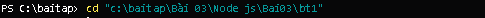
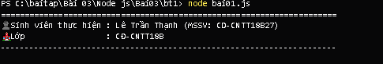

# BÀI TẬP 03 - BT01: LỌC DANH SÁCH SINH VIÊN BẰNG CLASS & ARROW FUNCTION

## 📌 Yêu cầu đề bài
> **Yêu cầu:** Tạo tập tin `bai01.js` thực hiện:
> - Khai báo danh sách 5 sinh viên, mỗi sinh viên gồm mã, họ tên, tuổi và điểm.
> - Sử dụng class, constructor để biểu diễn sinh viên.
> - Sử dụng hàm mũi tên (arrow function) để lọc sinh viên có điểm từ 5 trở lên.
> - Hiển thị danh sách sinh viên đạt yêu cầu bằng `console.log()`.
> - Chạy: `node bai01.js`
> - Kết quả: Terminal hiển thị đúng danh sách sinh viên đạt yêu cầu.

---

## 👨‍🎓 Thông tin sinh viên
* **Họ và tên:** Lê Trần Thạnh
* **Mã sinh viên (MSSV):** CD-CNTT18B27
* **Lớp:** CĐ-CNTT18B
* **Trường:** Trường Cao đẳng Kỹ thuật Công nghệ Nha Trang
* **Repository GitHub:** [https://github.com/Billmtp/Node.js](https://github.com/Billmtp/Node.js)

---

## 🛠️ Cấu trúc thư mục
```
Bài 03/Node js/Bai03/bt1/
├── bai01.js         # Mã nguồn quản lý và lọc sinh viên
├── package.json     # Cấu hình dự án và npm script
├── step1_cd.png     # Ảnh chụp thực tế lệnh cd
├── step2_run.png    # Ảnh chụp thực tế lệnh node bai01.js và kết quả
└── README.md        # Hướng dẫn chi tiết cách chạy và minh chứng
```

---

## 🚀 Các bước thực hiện & Minh chứng ảnh chụp thực tế từng bước

### Bước 1: Mở PowerShell và di chuyển vào thư mục bài tập
```powershell
cd "c:\baitap\Bài 03\Node js\Bai03\bt1"
```


---

### Bước 2: Chạy chương trình và hiển thị kết quả
```powershell
node bai01.js
```
*(Hoặc dùng lệnh `npm start`)*



---

## 🔍 Giải thích chi tiết mã nguồn (`bai01.js`)
1. **Định nghĩa Class & Constructor:**
   ```javascript
   class SinhVien {
       constructor(ma, hoTen, tuoi, diem) {
           this.ma = ma;
           this.hoTen = hoTen;
           this.tuoi = tuoi;
           this.diem = diem;
       }
   }
   ```
2. **Khai báo danh sách 5 sinh viên:** Khởi tạo danh sách gồm 5 đối tượng sinh viên từ class `SinhVien`.
3. **Lọc bằng Arrow Function:**
   ```javascript
   const sinhVienDatYeuCau = danhSachSinhVien.filter(sv => sv.diem >= 5);
   ```
4. **Hiển thị danh sách:** Sử dụng `console.log()` duyệt và xuất danh sách sinh viên đạt điểm $\ge 5$.
