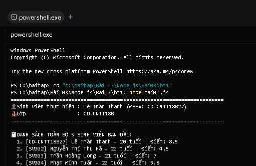

# BÀI TẬP 03 - BT01: LỌC DANH SÁCH SINH VIÊN BẰNG CLASS & ARROW FUNCTION

## 📌 Yêu cầu đề bài
> **Yêu cầu:** Tạo tập tin `bai01.js` thực hiện:
> - Khai báo danh sách 5 sinh viên, mỗi sinh viên gồm mã, họ tên, tuổi và điểm.
> - Sử dụng class, constructor để biểu diễn sinh viên.
> - Sử dụng hàm mũi tên (arrow function) để lọc sinh viên có điểm từ 5 trở lên.
> - Hiển thị danh sách sinh viên đạt yêu cầu bằng `console.log()`.
> - Chạy lệnh: `node bai01.js`
> - Kết quả: Terminal hiển thị đúng danh sách sinh viên đạt yêu cầu.

---

## 👨‍🎓 Thông tin sinh viên
* **Họ và tên:** Lê Trần Thạnh
* **Mã sinh viên (MSSV):** CD-CNTT18B27
* **Lớp:** CĐ-CNTT18B
* **Trường:** Trường Cao đẳng Kỹ thuật Công nghệ Nha Trang
* **Repository GitHub:** [https://github.com/Billmtp/Node.js](https://github.com/Billmtp/Node.js)
* **Đường dẫn thư mục:** `Bài 03/Node js/Bai03/bt1`

---

## 🛠️ Cấu trúc thư mục
```
Bài 03/Node js/Bai03/bt1/
├── bai01.js         # Mã nguồn thực thi quản lý và lọc sinh viên
├── package.json     # Cấu hình dự án và script npm
├── screenshot.png   # Ảnh chụp thực tế kết quả chạy lệnh trong Terminal
└── README.md        # Hướng dẫn chi tiết, mô tả mã nguồn và kết quả
```

---

## 🚀 Hướng dẫn các bước chạy code

### Bước 1: Mở Terminal / PowerShell và chuyển vào thư mục bài tập
```powershell
cd "Bài 03/Node js/Bai03/bt1"
```

### Bước 2: Chạy chương trình
Bạn có thể dùng 1 trong 2 lệnh sau:

* **Cách 1: Dùng lệnh Node trực tiếp:**
  ```powershell
  node bai01.js
  ```
* **Cách 2: Dùng script npm:**
  ```powershell
  npm start
  ```

---

## 📊 Kết quả thực thi trong Terminal
Khi chạy lệnh `node bai01.js`, màn hình terminal xuất ra:

```text
======================================================================
                 BÀI 03 - BÀI TẬP 01 (bt1): QUẢN LÝ SINH VIÊN        
======================================================================
👤 Sinh viên thực hiện : Lê Trần Thạnh (MSSV: CD-CNTT18B27)
🏫 Lớp                 : CĐ-CNTT18B
----------------------------------------------------------------------

📋 DANH SÁCH TOÀN BỘ 5 SINH VIÊN BAN ĐẦU:
  1. [CD-CNTT18B27] Lê Trần Thạnh - 20 tuổi | Điểm: 8.5
  2. [SV002] Nguyễn Thị Thu Hà - 20 tuổi | Điểm: 4.5
  3. [SV003] Trần Hoàng Long - 21 tuổi | Điểm: 7
  4. [SV004] Phạm Minh Tuấn - 20 tuổi | Điểm: 3.8
  5. [SV005] Võ Thảo My - 19 tuổi | Điểm: 9.2

🎯 DANH SÁCH SINH VIÊN ĐẠT YÊU CẦU (ĐIỂM >= 5):
----------------------------------------------------------------------
  1. Mã: CD-CNTT18B27   | Họ tên: Lê Trần Thạnh        | Tuổi: 20 | Điểm: 8.5
  2. Mã: SV003          | Họ tên: Trần Hoàng Long      | Tuổi: 21 | Điểm: 7
  3. Mã: SV005          | Họ tên: Võ Thảo My           | Tuổi: 19 | Điểm: 9.2
----------------------------------------------------------------------
=> Tổng số sinh viên đạt yêu cầu: 3/5 sinh viên.
======================================================================
```

---

## 🔍 Giải thích chi tiết mã nguồn (`bai01.js`)
1. **Định nghĩa Class & Constructor:**
   ```javascript
   class SinhVien {
       constructor(ma, hoTen, tuoi, diem) {
           this.ma = ma;
           this.hoTen = hoTen;
           this.tuoi = tuoi;
           this.diem = diem;
       }
   }
   ```
   * Giúp đóng gói thông tin sinh viên theo hướng đối tượng (OOP) chuẩn ES6.

2. **Khai báo danh sách 5 sinh viên:**
   * Sử dụng mảng (`Array`) chứa 5 đối tượng khởi tạo qua `new SinhVien(...)`.

3. **Lọc sinh viên bằng Arrow Function:**
   ```javascript
   const sinhVienDatYeuCau = danhSachSinhVien.filter(sv => sv.diem >= 5);
   ```
   * Hàm mũi tên `sv => sv.diem >= 5` làm callback cho phương thức `.filter()`, giữ lại các phần tử có thuộc tính `diem` từ 5 trở lên.

4. **Hiển thị danh sách bằng `console.log()`:**
   * Sử dụng vòng lặp duyệt mảng và in định dạng bảng đẹp mắt ra console.

---

## 📸 Hình ảnh minh chứng kết quả chạy thực tế

Ảnh chụp màn hình thực tế khi chạy lệnh `node bai01.js` trên máy:


