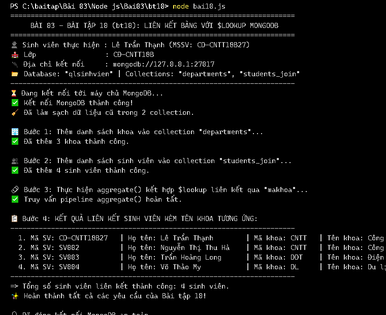

# BÀI TẬP 03 - BT10: LIÊN KẾT BẢNG VỚI AGGREGATE() VÀ $LOOKUP

## 📌 Yêu cầu đề bài
> **Yêu cầu:** Tạo tập tin `bai10.js`:
> - Tạo collection `departments` gồm ít nhất 2 khoa, mỗi khoa có `makhoa`, `tenkhoa`.
> - Tạo collection `students_join` gồm ít nhất 4 sinh viên, mỗi sinh viên có `masv`, `hoten`, `makhoa`.
> - Sử dụng `aggregate()` kết hợp `$lookup` để liên kết sinh viên với khoa thông qua `makhoa`.
> - Hiển thị danh sách sinh viên kèm tên khoa tương ứng.
> - Đảm bảo kết quả không chỉ hiển thị mã khoa mà còn có tên khoa.
> - Lệnh chạy: `node bai10.js`

---

## 👨‍🎓 Thông tin sinh viên
* **Họ và tên:** Lê Trần Thạnh
* **Mã sinh viên (MSSV):** CD-CNTT18B27
* **Lớp:** CĐ-CNTT18B
* **Trường:** Trường Cao đẳng Kỹ thuật Công nghệ Nha Trang
* **Repository GitHub:** [https://github.com/Billmtp/Node.js](https://github.com/Billmtp/Node.js)

---

## 🛠️ Cấu trúc thư mục
```
Bài 03/Node js/Bai03/bt10/
├── bai10.js         # Mã nguồn khởi tạo 2 collection và thực hiện $lookup
├── package.json     # Cấu hình dự án và thư viện mongodb
├── step1_cd.png     # Ảnh chụp thực tế lệnh cd
├── step2_run.png    # Ảnh chụp thực tế chạy node bai10.js và kết quả
└── README.md        # Hướng dẫn chi tiết cách chạy và minh chứng
```

---

## 🚀 Các bước thực hiện & Minh chứng ảnh chụp thực tế từng bước

### Bước 1: Mở PowerShell và di chuyển vào thư mục bài tập
```powershell
cd "c:\baitap\Bài 03\Node js\Bai03\bt10"
```


---

### Bước 2: Chạy chương trình liên kết bảng MongoDB
```powershell
node bai10.js
```
*(Hoặc dùng lệnh `npm start`)*



---

## 🔍 Giải thích các toán tử Aggregation trong MongoDB
1. **Toán tử `$lookup` (Left Outer Join):**
   * `from: 'departments'`: Tên collection cần liên kết sang.
   * `localField: 'makhoa'`: Trường khóa ngoại trong collection gốc `students_join`.
   * `foreignField: 'makhoa'`: Trường khóa chính trong collection liên kết `departments`.
   * `as: 'thongTinKhoa'`: Tên trường mảng chứa dữ liệu khoa sau khi ghép nối.
2. **Toán tử `$unwind`:**
   * Làm phẳng mảng đối tượng `thongTinKhoa` thành một đối tượng độc lập gắn trực tiếp vào bản ghi sinh viên.
3. **Toán tử `$project`:**
   * Chọn lọc và đổi tên các trường xuất ra cuối cùng: hiển thị `masv`, `hoten`, `makhoa`, và ánh xạ `tenkhoa: '$thongTinKhoa.tenkhoa'` để hiển thị tên khoa rõ ràng.
