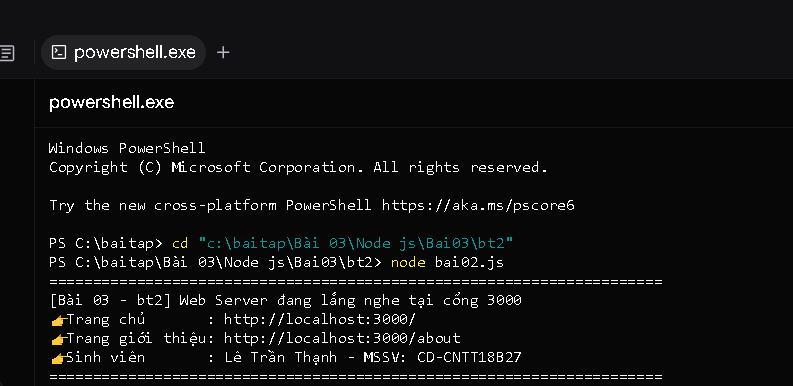
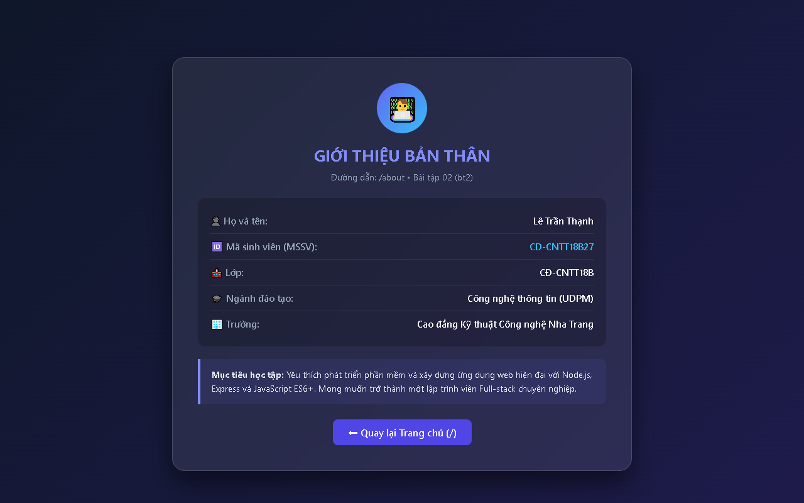
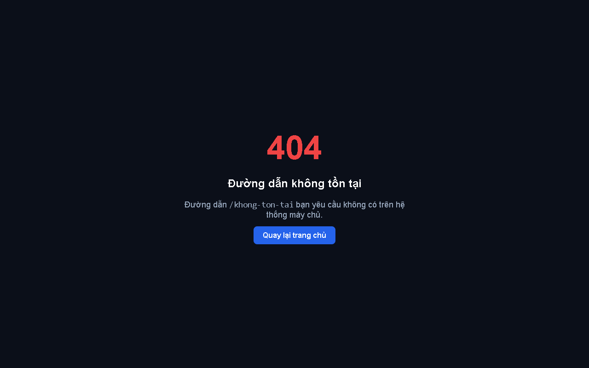

# BÀI TẬP 03 - BT02: TẠO WEB SERVER VỚI MODULE HTTP

## 📌 Yêu cầu đề bài
> **Yêu cầu:** Tạo tập tin `bai02.js` thực hiện:
> - Sử dụng module `http` tạo Web Server tại cổng `3000`.
> - Khi truy cập `/`, hiển thị lời chào và mã sinh viên.
> - Khi truy cập `/about`, hiển thị thông tin giới thiệu bản thân.
> - Khi truy cập đường dẫn không tồn tại, trả về mã trạng thái HTTP `404`.
> - Chạy: `node bai02.js`
> - Kết quả: Trình duyệt hiển thị đúng nội dung tại `http://localhost:3000` và `http://localhost:3000/about`.

---

## 👨‍🎓 Thông tin sinh viên
* **Họ và tên:** Lê Trần Thạnh
* **Mã sinh viên (MSSV):** CD-CNTT18B27
* **Lớp:** CĐ-CNTT18B
* **Trường:** Trường Cao đẳng Kỹ thuật Công nghệ Nha Trang
* **Repository GitHub:** [https://github.com/Billmtp/Node.js](https://github.com/Billmtp/Node.js)
* **Đường dẫn thư mục:** `Bài 03/Node js/Bai03/bt2`

---

## 🛠️ Cấu trúc thư mục
```
Bài 03/Node js/Bai03/bt2/
├── bai02.js          # Mã nguồn Web Server HTTP xử lý định tuyến (/) và (/about)
├── package.json      # Cấu hình dự án và npm script
├── step1_cd.png      # Ảnh chụp thực tế lệnh di chuyển thư mục cd
├── terminal_server.png # Ảnh chụp thực tế Terminal chạy node bai02.js
├── browser_home.png  # Ảnh chụp thực tế trình duyệt truy cập http://localhost:3000
├── browser_about.png # Ảnh chụp thực tế trình duyệt truy cập http://localhost:3000/about
├── browser_404.png   # Ảnh chụp thực tế trình duyệt khi gặp đường dẫn 404
└── README.md         # Hướng dẫn chi tiết cách chạy và mô tả các bước
```

---

## 🚀 Các bước thực hiện & Ảnh minh chứng thực tế 100%

### Bước 1: Mở Terminal / PowerShell và chuyển vào thư mục bài tập
```powershell
cd "Bài 03/Node js/Bai03/bt2"
```
📸 **Ảnh chụp màn hình thực tế lệnh `cd`:**


---

### Bước 2: Khởi chạy máy chủ Web
```powershell
node bai02.js
```
*(Hoặc dùng lệnh `npm start`)*

📸 **Ảnh chụp màn hình thực tế Terminal khi khởi chạy server thành công:**



---

### Bước 3: Mở trình duyệt web kiểm tra từng đường dẫn

#### 1. Truy cập Trang chủ (`http://localhost:3000/`)
* **Yêu cầu:** Hiển thị lời chào và mã sinh viên.
* 📸 **Ảnh chụp màn hình thực tế trình duyệt:**


---

#### 2. Truy cập Trang giới thiệu bản thân (`http://localhost:3000/about`)
* **Yêu cầu:** Hiển thị thông tin giới thiệu bản thân (Họ tên, MSSV, Lớp, Trường).
* 📸 **Ảnh chụp màn hình thực tế trình duyệt:**



---

#### 3. Kiểm tra đường dẫn không tồn tại (Mã trạng thái HTTP 404)
* **Yêu cầu:** Trả về thông báo lỗi 404 khi truy cập sai URL.
* 📸 **Ảnh chụp màn hình thực tế trình duyệt:**


