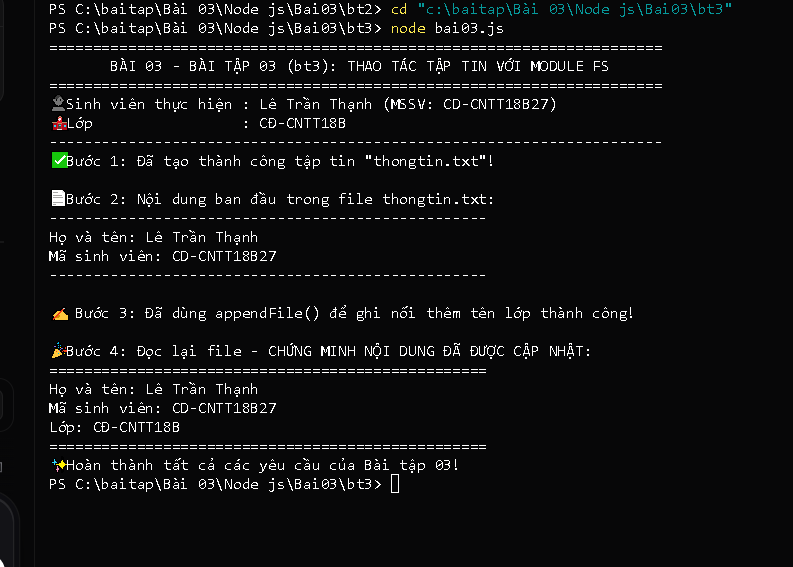

# BÀI TẬP 03 - BT03: SẮP XẾP BẢNG XẾP HẠNG SINH VIÊN BẰNG ARROW FUNCTION & ASYNC/AWAIT

## 📌 Yêu cầu bài tập
> **Nội dung:**
> - Tiếp tục phát triển danh sách `SinhVien`.
> - Sử dụng hàm mũi tên (Arrow Function) kết hợp phương thức `.sort((a, b) => b.diem - a.diem)` để sắp xếp danh sách theo thứ tự điểm giảm dần.
> - Sử dụng Promise và async/await mô phỏng việc tải dữ liệu bất đồng bộ.
> - Hiển thị bảng xếp hạng chi tiết ra màn hình console.

---

## 👨‍🎓 Thông tin sinh viên
* **Họ và tên:** Lê Trần Thạnh
* **Mã sinh viên (MSSV):** CD-CNTT18B27
* **Lớp:** CĐ-CNTT18B
* **Trường:** Trường Cao đẳng Kỹ thuật Công nghệ Nha Trang
* **Repository GitHub:** [https://github.com/Billmtp/Node.js](https://github.com/Billmtp/Node.js)
* **Đường dẫn thư mục:** `Bài 03/Node js/Bai03/bt3`

---

## 🛠️ Cấu trúc thư mục
```
Bài 03/Node js/Bai03/bt3/
├── bai03.js         # Mã nguồn sắp xếp sinh viên và xử lý bất đồng bộ
├── package.json     # Cấu hình dự án và npm script
├── screenshot.png   # Ảnh chụp thực tế kết quả chạy lệnh trong Terminal
└── README.md        # Hướng dẫn chi tiết cách chạy và mô tả kết quả
```

---

## 🚀 Hướng dẫn các bước chạy code

### Bước 1: Mở Terminal / PowerShell và chuyển vào thư mục bài tập
```powershell
cd "Bài 03/Node js/Bai03/bt3"
```

### Bước 2: Chạy chương trình
```powershell
node bai03.js
```
*(Hoặc dùng lệnh `npm start`)*

---

## 📊 Kết quả thực thi trong Terminal
Khi chạy lệnh `node bai03.js`, màn hình terminal xuất ra:

```text
======================================================================
       BÀI 03 - BÀI TẬP 03 (bt3): SẮP XẾP BẢNG XẾP HẠNG SINH VIÊN     
======================================================================
👤 Sinh viên thực hiện : Lê Trần Thạnh (MSSV: CD-CNTT18B27)
🏫 Lớp                 : CĐ-CNTT18B
----------------------------------------------------------------------
⏳ Đang đồng bộ và xử lý dữ liệu sinh viên...

🏆 BẢNG XẾP HẠNG SINH VIÊN THEO ĐIỂM SỐ (GIẢM DẦN):
----------------------------------------------------------------------
 Hạng | Mã SV          | Họ và tên            | Tuổi | Điểm
----------------------------------------------------------------------
  Top 1 | SV005          | Võ Thảo My           |  19  | 9.2
  Top 2 | CD-CNTT18B27   | Lê Trần Thạnh        |  20  | 8.5
  Top 3 | SV003          | Trần Hoàng Long      |  21  | 7
  Top 4 | SV002          | Nguyễn Thị Thu Hà    |  20  | 4.5
  Top 5 | SV004          | Phạm Minh Tuấn       |  20  | 3.8
----------------------------------------------------------------------
✅ Đã hoàn thành sắp xếp và hiển thị toàn bộ danh sách thành công.
======================================================================
```

---

## 📸 Hình ảnh minh chứng kết quả chạy thực tế

Ảnh chụp màn hình thực tế khi chạy lệnh `node bai03.js` trên máy:


