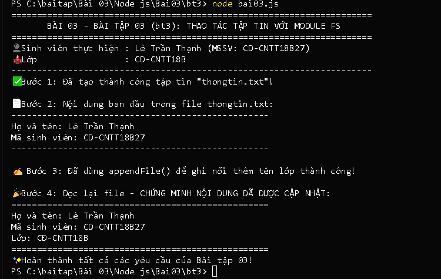

# BÀI TẬP 03 - BT03: THAO TÁC TẬP TIN VỚI MODULE FS

## 📌 Yêu cầu đề bài
> **Yêu cầu:** Tạo tập tin `bai03.js` sử dụng module `fs`:
> - Tạo tập tin `thongtin.txt` chứa họ tên và mã sinh viên.
> - Đọc và hiển thị nội dung tập tin lên Terminal.
> - Ghi nối thêm tên lớp vào cuối tập tin bằng `appendFile()`.
> - Đọc lại tập tin để chứng minh nội dung đã được cập nhật.
> - Chạy: `node bai03.js`
> - Kết quả: Tập tin được tạo, cập nhật và Terminal hiển thị đầy đủ nội dung sau cập nhật.

---

## 👨‍🎓 Thông tin sinh viên
* **Họ và tên:** Lê Trần Thạnh
* **Mã sinh viên (MSSV):** CD-CNTT18B27
* **Lớp:** CĐ-CNTT18B
* **Trường:** Trường Cao đẳng Kỹ thuật Công nghệ Nha Trang
* **Repository GitHub:** [https://github.com/Billmtp/Node.js](https://github.com/Billmtp/Node.js)

---

## 🛠️ Cấu trúc thư mục
```
Bài 03/Node js/Bai03/bt3/
├── bai03.js         # Mã nguồn thao tác file với module fs
├── thongtin.txt     # Tập tin dữ liệu được tạo và cập nhật
├── package.json     # Cấu hình dự án và npm script
├── step1_cd.png     # Ảnh chụp thực tế lệnh cd
├── step2_run.png    # Ảnh chụp thực tế chạy node bai03.js và kết quả 4 bước
└── README.md        # Hướng dẫn chi tiết cách chạy và minh chứng
```

---

## 🚀 Các bước thực hiện & Minh chứng ảnh chụp thực tế từng bước

### Bước 1: Mở PowerShell và di chuyển vào thư mục bài tập
```powershell
cd "c:\baitap\Bài 03\Node js\Bai03\bt3"
```


---

### Bước 2: Chạy chương trình thao tác với file
```powershell
node bai03.js
```
*(Hoặc dùng lệnh `npm start`)*



---

## 🔍 Giải thích các hàm của module `fs` được sử dụng
1. `fs.writeFileSync()`: Tạo mới và ghi đè nội dung ban đầu (Họ tên, MSSV) vào file `thongtin.txt`.
2. `fs.readFileSync()`: Đọc dữ liệu từ file dạng text với bảng mã `'utf-8'`.
3. `fs.appendFileSync()`: Ghi nối thêm dữ liệu (Tên lớp) vào cuối file mà không làm mất nội dung trước đó.
