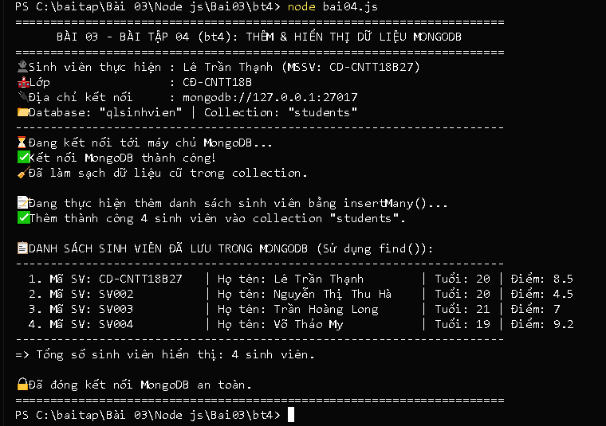

# BÀI TẬP 03 - BT04: KẾT NỐI MONGODB, THÊM VÀ HIỂN THỊ DỮ LIỆU

## 📌 Yêu cầu đề bài
> **Yêu cầu bài thực hành:** Tạo tập tin `bai04.js` thực hiện:
> - Kết nối MongoDB đang chạy trên máy.
> - Sử dụng database `qlsinhvien`, collection `students`.
> - Thêm ít nhất 3 sinh viên bằng `insertMany()`, mỗi sinh viên gồm `masv`, `hoten`, `tuoi`, `diem`.
> - Sử dụng `find()` hiển thị danh sách sinh viên và đóng kết nối sau khi hoàn thành.
> - Chạy: `node bai04.js`
> - Kết quả: Terminal hiển thị các sinh viên đã thêm; dữ liệu được lưu trong MongoDB.

---

## 👨‍🎓 Thông tin sinh viên
* **Họ và tên:** Lê Trần Thạnh
* **Mã sinh viên (MSSV):** CD-CNTT18B27
* **Lớp:** CĐ-CNTT18B
* **Trường:** Trường Cao đẳng Kỹ thuật Công nghệ Nha Trang
* **Repository GitHub:** [https://github.com/Billmtp/Node.js](https://github.com/Billmtp/Node.js)
* **Đường dẫn thư mục:** `Bài 03/Node js/Bai03/bt4`

---

## 🛠️ Cấu trúc thư mục
```
Bài 03/Node js/Bai03/bt4/
├── bai04.js         # Mã nguồn kết nối MongoDB, insertMany() và find()
├── package.json     # Cấu hình dự án và thư viện mongodb
├── screenshot.png   # Ảnh chụp thực tế kết quả chạy trên Terminal
└── README.md        # Hướng dẫn chi tiết cách chạy và mô tả các bước
```

---

## 🚀 Các bước thực hiện & Hướng dẫn chạy code

### Bước 1: Khởi động dịch vụ MongoDB
Đảm bảo máy chủ MongoDB đang chạy trên máy tính (cổng 27017). Bạn có thể mở ứng dụng **MongoDB Compass** hoặc chạy lệnh trong cmd với quyền Administrator:
```powershell
net start MongoDB
```

### Bước 2: Mở Terminal / PowerShell và chuyển vào thư mục bài tập
```powershell
cd "Bài 03/Node js/Bai03/bt4"
```
📸 **Ảnh chụp màn hình thực tế lệnh `cd`:**


### Bước 3: Chạy chương trình kết nối MongoDB
```powershell
node bai04.js
```
*(Hoặc dùng lệnh `npm start`)*

📸 **Ảnh chụp màn hình thực tế khi chạy lệnh và kết quả MongoDB:**



---

## 📊 Kết quả thực thi trong Terminal
Khi chạy lệnh `node bai04.js`, màn hình terminal xuất ra:

```text
======================================================================
      BÀI 03 - BÀI TẬP 04 (bt4): THÊM & HIỂN THỊ DỮ LIỆU MONGODB      
======================================================================
👤 Sinh viên thực hiện : Lê Trần Thạnh (MSSV: CD-CNTT18B27)
🏫 Lớp                 : CĐ-CNTT18B
🔌 Địa chỉ kết nối     : mongodb://127.0.0.1:27017
📂 Database: "qlsinhvien" | Collection: "students"
----------------------------------------------------------------------
⏳ Đang kết nối tới máy chủ MongoDB...
✅ Kết nối MongoDB thành công!
🧹 Đã làm sạch dữ liệu cũ trong collection.

📝 Đang thực hiện thêm danh sách sinh viên bằng insertMany()...
✅ Thêm thành công 4 sinh viên vào collection "students".

📋 DANH SÁCH SINH VIÊN ĐÃ LƯU TRONG MONGODB (Sử dụng find()):
----------------------------------------------------------------------
  1. Mã SV: CD-CNTT18B27   | Họ tên: Lê Trần Thạnh        | Tuổi: 20 | Điểm: 8.5
  2. Mã SV: SV002          | Họ tên: Nguyễn Thị Thu Hà    | Tuổi: 20 | Điểm: 4.5
  3. Mã SV: SV003          | Họ tên: Trần Hoàng Long      | Tuổi: 21 | Điểm: 7
  4. Mã SV: SV004          | Họ tên: Võ Thảo My           | Tuổi: 19 | Điểm: 9.2
----------------------------------------------------------------------
=> Tổng số sinh viên hiển thị: 4 sinh viên.

🔒 Đã đóng kết nối MongoDB an toàn.
======================================================================
```

---

## 🔍 Giải thích các thao tác kỹ thuật
1. **Kết nối:** Dùng `const client = new MongoClient(URI); await client.connect();` theo chuẩn Driver MongoDB v6+.
2. **Chọn CSDL & Collection:** `const db = client.db('qlsinhvien'); const col = db.collection('students');`.
3. **Thêm dữ liệu:** `await col.insertMany(danhSach);` để chèn đồng thời nhiều bản ghi.
4. **Truy vấn:** `await col.find({}).toArray();` lấy toàn bộ tài liệu đã lưu.
5. **Đóng kết nối:** `await client.close();` đảm bảo giải phóng tài nguyên.

---

## 📸 Hình ảnh minh chứng kết quả chạy thực tế

Ảnh chụp màn hình thực tế khi chạy lệnh `node bai04.js` trên máy:


