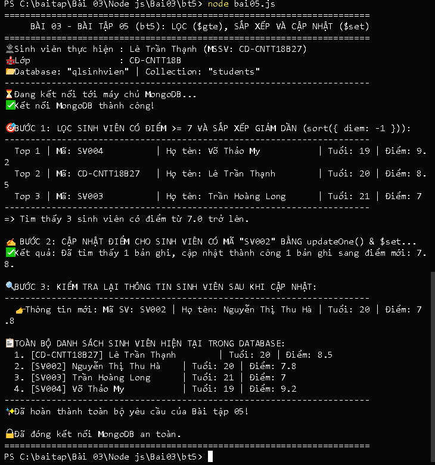

# BÀI TẬP 03 - BT05: TRUY VẤN NÂNG CAO ($gte), SẮP XẾP (sort) VÀ CẬP NHẬT ($set) MONGODB

## 📌 Yêu cầu đề bài
> **Yêu cầu:** Tạo tập tin `bai05.js`, sử dụng collection `students` của Bài 4:
> - Tìm các sinh viên có `diem >= 7` bằng `find()` và `$gte`.
> - Sắp xếp kết quả theo điểm giảm dần bằng `sort()`.
> - Cập nhật điểm của một sinh viên theo `masv` bằng `updateOne()` và `$set`.
> - Hiển thị lại thông tin sau cập nhật để kiểm tra kết quả.
> - Chạy: `node bai05.js`
> - Kết quả: Hiển thị danh sách lọc, sắp xếp đúng và điểm sinh viên được cập nhật thành công.

---

## 👨‍🎓 Thông tin sinh viên
* **Họ và tên:** Lê Trần Thạnh
* **Mã sinh viên (MSSV):** CD-CNTT18B27
* **Lớp:** CĐ-CNTT18B
* **Trường:** Trường Cao đẳng Kỹ thuật Công nghệ Nha Trang
* **Repository GitHub:** [https://github.com/Billmtp/Node.js](https://github.com/Billmtp/Node.js)

---

## 🛠️ Cấu trúc thư mục
```
Bài 03/Node js/Bai03/bt5/
├── bai05.js         # Mã nguồn lọc $gte, sắp xếp sort() và updateOne() $set
├── package.json     # Cấu hình dự án và thư viện mongodb
├── step1_cd.png     # Ảnh chụp thực tế lệnh cd
├── step2_run.png    # Ảnh chụp thực tế chạy node bai05.js và kết quả
└── README.md        # Hướng dẫn chi tiết cách chạy và minh chứng
```

---

## 🚀 Các bước thực hiện & Minh chứng ảnh chụp thực tế từng bước

### Bước 1: Mở PowerShell và di chuyển vào thư mục bài tập
```powershell
cd "c:\baitap\Bài 03\Node js\Bai03\bt5"
```


---

### Bước 2: Chạy chương trình truy vấn và cập nhật
```powershell
node bai05.js
```
*(Hoặc dùng lệnh `npm start`)*



---

## 🔍 Giải thích các toán tử MongoDB trong mã nguồn
1. **Toán tử so sánh `$gte` (Greater Than or Equal):**
   * Cú pháp: `{ diem: { $gte: 7 } }` giúp lọc các sinh viên có điểm $\ge 7.0$.
2. **Phương thức sắp xếp `.sort()`:**
   * Cú pháp: `.sort({ diem: -1 })` sắp xếp thứ tự điểm giảm dần (từ cao xuống thấp).
3. **Cập nhật với `updateOne()` và `$set`:**
   * Cú pháp: `await collection.updateOne({ masv: 'SV002' }, { $set: { diem: 7.8 } });`
   * Chỉ cập nhật trường `diem` của sinh viên chỉ định mà không làm mất các trường dữ liệu khác.
4. **Đóng kết nối:** `await client.close();` đảm bảo đóng kết nối cơ sở dữ liệu sau khi thực thi.
