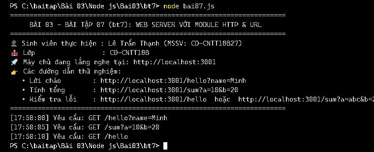
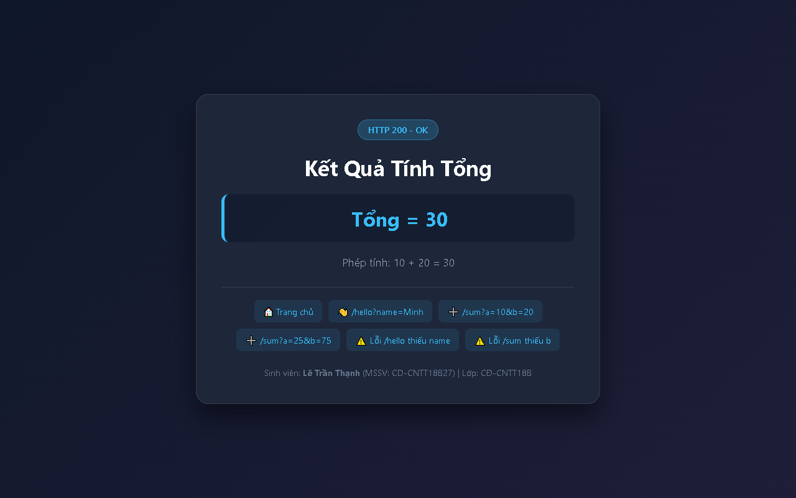

# BÀI TẬP 03 - BT07: WEB SERVER VỚI MODULE HTTP VÀ ĐỐI TƯỢNG URL

## 📌 Yêu cầu đề bài
> **Yêu cầu:** Tạo tập tin `bai07.js`:
> - Sử dụng module `http` và đối tượng `URL`.
> - Tạo Web Server tại cổng `3001`.
> - Khi truy cập `/hello?name=Minh`, hiển thị `Xin chào Minh`.
> - Khi truy cập `/sum?a=10&b=20`, hiển thị `Tổng = 30`.
> - Trả về thông báo lỗi nếu thiếu tham số hoặc giá trị không hợp lệ.
> - Lệnh chạy: `node bai07.js`

---

## 👨‍🎓 Thông tin sinh viên
* **Họ và tên:** Lê Trần Thạnh
* **Mã sinh viên (MSSV):** CD-CNTT18B27
* **Lớp:** CĐ-CNTT18B
* **Trường:** Trường Cao đẳng Kỹ thuật Công nghệ Nha Trang
* **Repository GitHub:** [https://github.com/Billmtp/Node.js](https://github.com/Billmtp/Node.js)

---

## 🛠️ Cấu trúc thư mục
```
Bài 03/Node js/Bai03/bt7/
├── bai07.js           # Mã nguồn Web Server HTTP xử lý /hello và /sum bằng URL
├── package.json       # Cấu hình dự án và npm script
├── step1_cd.png       # Ảnh chụp thực tế lệnh cd
├── step2_run.png      # Ảnh chụp thực tế Terminal khởi chạy server
├── browser_hello.png  # Ảnh chụp thực tế trình duyệt truy cập /hello?name=Minh
├── browser_sum.png    # Ảnh chụp thực tế trình duyệt truy cập /sum?a=10&b=20
├── browser_error.png  # Ảnh chụp thực tế trình duyệt khi thiếu hoặc sai tham số
└── README.md          # Hướng dẫn chi tiết cách chạy và minh chứng
```

---

## 🚀 Các bước thực hiện & Minh chứng ảnh chụp thực tế từng bước

### Bước 1: Mở PowerShell và di chuyển vào thư mục bài tập
```powershell
cd "c:\baitap\Bài 03\Node js\Bai03\bt7"
```


---

### Bước 2: Khởi chạy máy chủ Web
```powershell
node bai07.js
```
*(Hoặc dùng lệnh `npm start`)*



---

### Bước 3: Mở trình duyệt web kiểm tra từng chức năng

#### 1. Kiểm tra chức năng Lời chào (`/hello?name=Minh`)
* **URL:** [http://localhost:3001/hello?name=Minh](http://localhost:3001/hello?name=Minh)
* **Kết quả:** Hiển thị `Xin chào Minh`.


---

#### 2. Kiểm tra chức năng Tính tổng (`/sum?a=10&b=20`)
* **URL:** [http://localhost:3001/sum?a=10&b=20](http://localhost:3001/sum?a=10&b=20)
* **Kết quả:** Hiển thị `Tổng = 30`.



---

#### 3. Kiểm tra trường hợp thiếu tham số hoặc giá trị không hợp lệ
* **URL thử nghiệm:** [http://localhost:3001/hello](http://localhost:3001/hello) hoặc [http://localhost:3001/sum?a=10](http://localhost:3001/sum?a=10)
* **Kết quả:** Trả về mã lỗi HTTP 400 kèm thông báo chi tiết.


---

## 🔍 Giải thích các thao tác kỹ thuật
1. **Module `http`:** Sử dụng `http.createServer()` để khởi tạo Web Server tại cổng `3001`.
2. **Đối tượng `URL`:** 
   * Cú pháp `const reqUrl = new URL(req.url, 'http://localhost:3001');` theo chuẩn WHATWG tích hợp sẵn trong Node.js.
   * `reqUrl.pathname`: Xác định tuyến đường được gọi (`/hello`, `/sum`, `/`).
   * `reqUrl.searchParams.get('key')`: Trích xuất giá trị tham số trên Query String.
3. **Xử lý tham số & Validation:**
   * Kiểm tra sự tồn tại của tham số bằng `searchParams.has()` và kiểm tra rỗng.
   * Kiểm tra tính hợp lệ số học bằng `Number()` và `isNaN()`.
   * Trả về mã lỗi `400 Bad Request` khi tham số không hợp lệ và mã `404 Not Found` khi truy cập sai tuyến đường.
