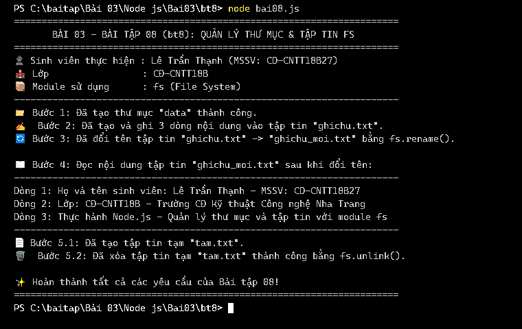

# BÀI TẬP 03 - BT08: QUẢN LÝ THƯ MỤC VÀ TẬP TIN VỚI MODULE FS

## 📌 Yêu cầu đề bài
> **Yêu cầu:** Tạo tập tin `bai08.js`:
> - Sử dụng module `fs` tạo thư mục `data` và tập tin `ghichu.txt`.
> - Ghi vào tập tin ít nhất 3 dòng nội dung.
> - Đổi tên tập tin thành `ghichu_moi.txt` bằng `fs.rename()`.
> - Đọc và hiển thị nội dung sau khi đổi tên.
> - Tạo tập tin `tam.txt`, sau đó xóa bằng `fs.unlink()`.
> - Hiển thị thông báo kết quả từng thao tác.
> - Lệnh chạy: `node bai08.js`

---

## 👨‍🎓 Thông tin sinh viên
* **Họ và tên:** Lê Trần Thạnh
* **Mã sinh viên (MSSV):** CD-CNTT18B27
* **Lớp:** CĐ-CNTT18B
* **Trường:** Trường Cao đẳng Kỹ thuật Công nghệ Nha Trang
* **Repository GitHub:** [https://github.com/Billmtp/Node.js](https://github.com/Billmtp/Node.js)

---

## 🛠️ Cấu trúc thư mục
```
Bài 03/Node js/Bai03/bt8/
├── data/
│   └── ghichu_moi.txt  # Tập tin ghi chú sau khi đổi tên
├── bai08.js            # Mã nguồn thực hiện các thao tác quản lý file & thư mục
├── package.json        # Cấu hình dự án và npm script
├── step1_cd.png        # Ảnh chụp thực tế lệnh cd
├── step2_run.png       # Ảnh chụp thực tế chạy node bai08.js và kết quả
└── README.md           # Hướng dẫn chi tiết cách chạy và minh chứng
```

---

## 🚀 Các bước thực hiện & Minh chứng ảnh chụp thực tế từng bước

### Bước 1: Mở PowerShell và di chuyển vào thư mục bài tập
```powershell
cd "c:\baitap\Bài 03\Node js\Bai03\bt8"
```


---

### Bước 2: Chạy chương trình thao tác với thư mục và tập tin
```powershell
node bai08.js
```
*(Hoặc dùng lệnh `npm start`)*



---

## 🔍 Giải thích các hàm trong module `fs`
1. `fs.mkdirSync()`: Tạo thư mục mới `data` để tổ chức lưu trữ tập tin.
2. `fs.writeFileSync()`: Tạo và ghi 3 dòng thông tin vào tập tin `ghichu.txt`.
3. `fs.renameSync()`: Đổi tên tập tin từ `ghichu.txt` thành `ghichu_moi.txt`.
4. `fs.readFileSync()`: Đọc và hiển thị nội dung tập tin sau khi đổi tên theo chuẩn `'utf-8'`.
5. `fs.unlinkSync()`: Xóa tập tin tạm thời `tam.txt` khỏi hệ thống tệp tin an toàn.
