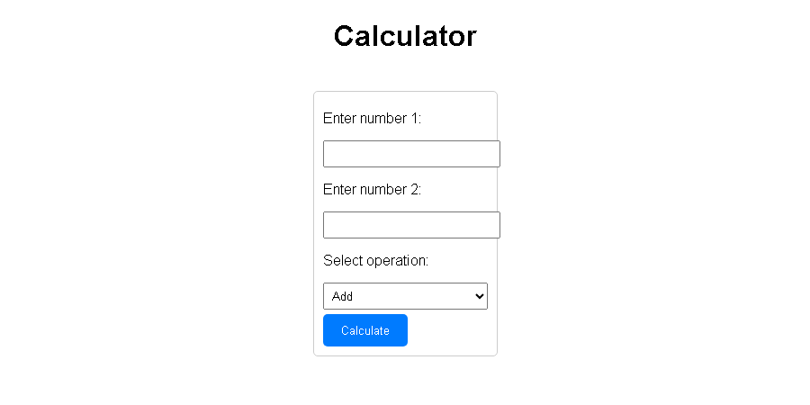

# BÀI 04 (BAITAPVIDU) — BÀI TẬP VÍ DỤ EXPRESS FRAMEWORK

## 📌 Yêu cầu đề bài
> **Yêu cầu:** Thực hành toàn bộ các ví dụ trong tài liệu **Bài 4: Xây dựng web với nền tảng Express (Express Framework)**:
> 1. Tạo ứng dụng đầu tiên với Express (`app.js`).
> 2. Định tuyến Route trong Express (`express_route.js`).
> 3. Middleware ghi log (`express_middleware.js`).
> 4. Template engine Pug (`express_pug.js` + `views/index.pug`).
> 5. Error handling với `body-parser` (`express_errorhandling.js`).
> 6. Dự án ứng dụng Calculator theo mô hình MVC (`my-express-app/`).

---

## 👨‍🎓 Thông tin sinh viên
* **Họ và tên:** Lê Trần Thạnh
* **Mã sinh viên (MSSV):** CD-CNTT18B27
* **Lớp:** CĐ-CNTT18B
* **Trường:** Trường Cao đẳng Kỹ thuật Công nghệ Nha Trang
* **Repository GitHub:** [https://github.com/Billmtp/Node.js](https://github.com/Billmtp/Node.js)

---

## 🛠️ Cấu trúc thư mục
```
Bài 04 - Xây dựng web với nền tảng Express/Baitapvidu/
├── app.js                      # Ví dụ 1: Ứng dụng Express đầu tiên
├── express_route.js            # Ví dụ 2: Route (/, /about, /users, 404)
├── express_middleware.js       # Ví dụ 3: Middleware ghi log
├── express_pug.js              # Ví dụ 4: Template engine Pug
├── views/index.pug             # Giao diện Pug cho Ví dụ 4
├── express_errorhandling.js    # Ví dụ 5: Xử lý lỗi phép chia (/divide)
├── my-express-app/             # Ví dụ 6: Dự án Calculator theo mô hình MVC
│   ├── app.js
│   ├── controllers/calculatorController.js
│   ├── models/calculatorModel.js
│   ├── views/calculator.pug
│   └── public/styles.css
├── package.json
└── README.md
```

---

## 🚀 Các bước thực hiện & Kết quả từng ví dụ

### Bước chuẩn bị: Di chuyển vào thư mục và cài đặt thư viện
```powershell
cd "c:\baitap\Bài 04 - Xây dựng web với nền tảng Express\Baitapvidu"
npm install
```


---

### Ví dụ 1: Tạo ứng dụng đầu tiên với Express
```powershell
node app.js
```
Truy cập `http://localhost:3000`:


---

### Ví dụ 2: Route trong Express
```powershell
node express_route.js
```
* Trang chủ `http://localhost:3000`:


* Trang giới thiệu `http://localhost:3000/about`:


* Tham số query `http://localhost:3000/users?name=Minh`:


---

### Ví dụ 3: Middleware ghi log
```powershell
node express_middleware.js
```
Truy cập `http://localhost:3000`:


---

### Ví dụ 4: Template engine (Pug)
```powershell
node express_pug.js
```
Truy cập `http://localhost:3000`:


---

### Ví dụ 5: Error handling
```powershell
node express_errorhandling.js
```
Truy cập `http://localhost:3000` (nhập `dividend` và `divisor`, nếu `divisor = 0` trả về HTTP 400 `Invalid input`):


---

### Ví dụ 6: Dự án ứng dụng Express theo mô hình MVC (Calculator)
```powershell
node my-express-app/app.js
```
Truy cập `http://localhost:3000/calculator`:


