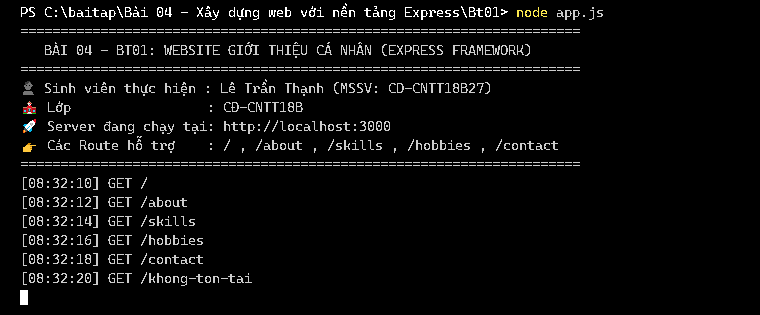
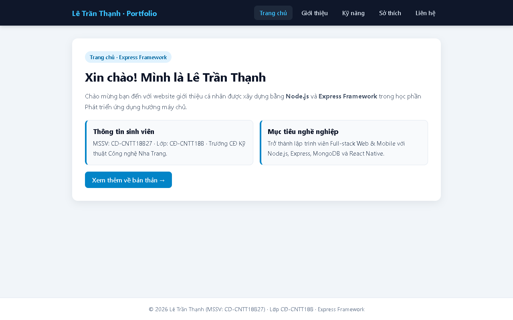
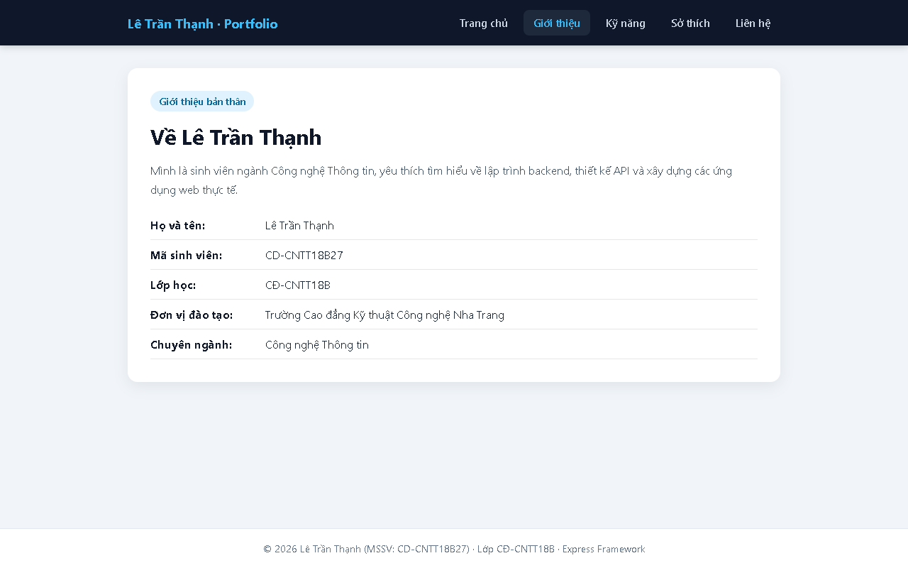
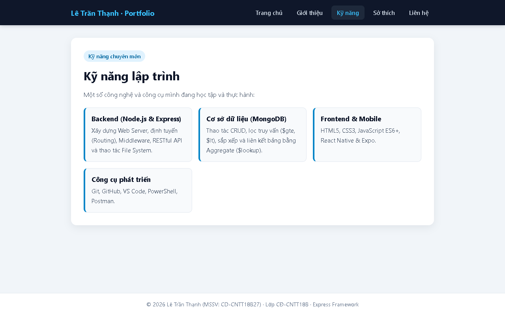
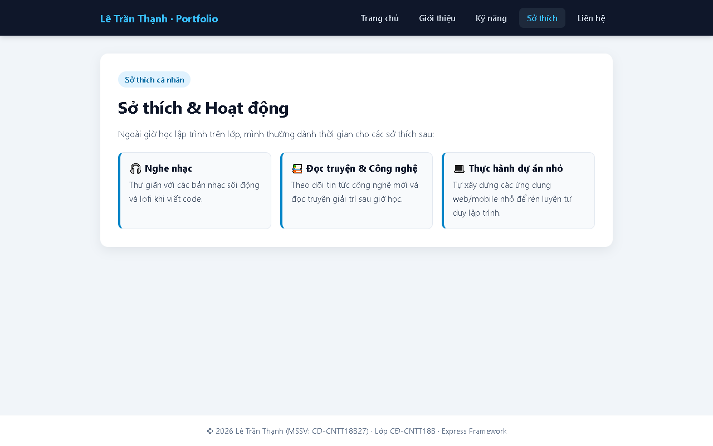
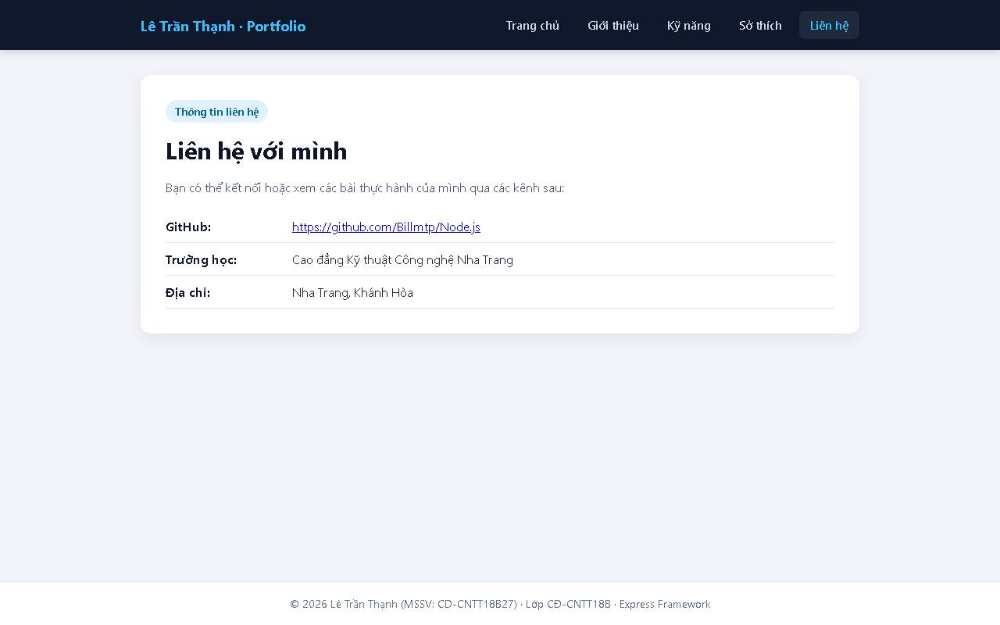
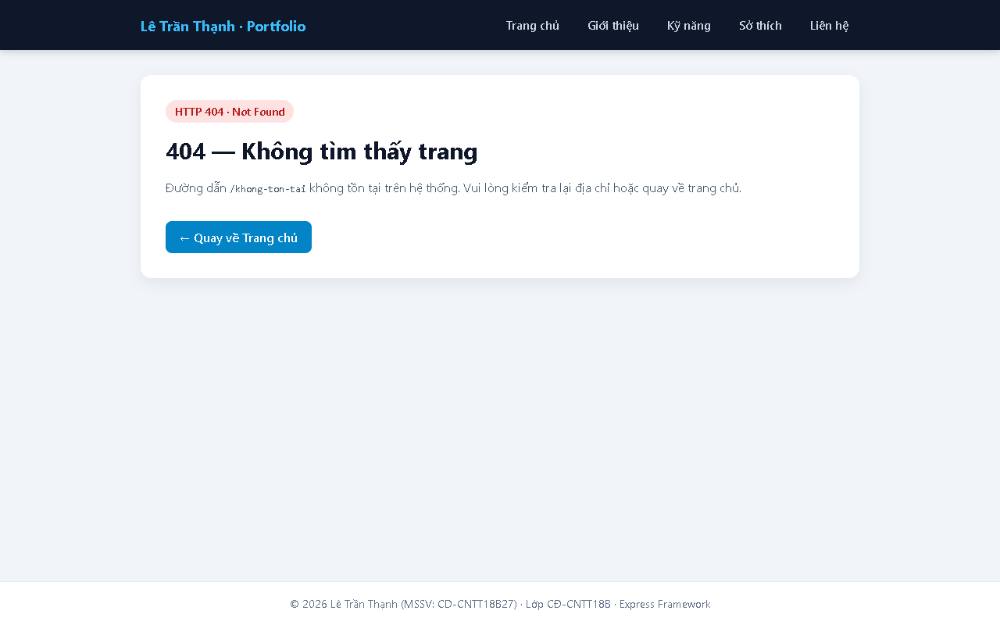

# BÀI 04 (BT01) — BÀI 01. XÂY DỰNG WEBSITE GIỚI THIỆU CÁ NHÂN

## 📌 Yêu cầu đề bài
> **Yêu cầu:**
> - Khởi tạo dự án Node.js và cài đặt Express.
> - Xây dựng các Route `/`, `/about`, `/skills`, `/hobbies`, `/contact`.
> - Thiết kế giao diện HTML/CSS đơn giản, có menu điều hướng.
> - Xử lý đường dẫn không tồn tại (HTTP 404).
> - Khảo sát ít nhất 3 dịch vụ hosting miễn phí hỗ trợ Node.js, lựa chọn một dịch vụ để triển khai.

---

## 👨‍🎓 Thông tin sinh viên
* **Họ và tên:** Lê Trần Thạnh
* **Mã sinh viên (MSSV):** CD-CNTT18B27
* **Lớp:** CĐ-CNTT18B
* **Trường:** Trường Cao đẳng Kỹ thuật Công nghệ Nha Trang
* **Repository GitHub:** [https://github.com/Billmtp/Node.js](https://github.com/Billmtp/Node.js)

---

## 🛠️ Cấu trúc thư mục
```
Bài 04 - Xây dựng web với nền tảng Express/Bt01/
├── public/
│   └── style.css         # Giao diện CSS (menu điều hướng, bố cục thẻ, responsive)
├── app.js                # Máy chủ Express xử lý 5 route và lỗi 404
├── package.json          # Cấu hình dự án Node.js và dependency express
├── step1_cd.png          # Ảnh thực tế lệnh cd
├── step2_run.png         # Ảnh thực tế chạy node app.js
├── browser_home.png      # Ảnh trình duyệt route /
├── browser_about.png     # Ảnh trình duyệt route /about
├── browser_skills.png    # Ảnh trình duyệt route /skills
├── browser_hobbies.png   # Ảnh trình duyệt route /hobbies
├── browser_contact.png   # Ảnh trình duyệt route /contact
├── browser_404.png       # Ảnh trình duyệt lỗi 404
└── README.md             # Tài liệu hướng dẫn chạy localhost và triển khai free host
```

---

## 🚀 Phần 1: Các bước thực hiện và kết quả trên máy cá nhân (localhost)

### Bước 1: Mở PowerShell và di chuyển vào thư mục bài tập
```powershell
cd "c:\baitap\Bài 04 - Xây dựng web với nền tảng Express\Bt01"
```


### Bước 2: Cài đặt Express và khởi chạy máy chủ
```powershell
npm install
node app.js
```


### Bước 3: Kiểm tra các Route trên trình duyệt (`http://localhost:3000`)

#### 1. Trang chủ (`/`)


#### 2. Giới thiệu (`/about`)


#### 3. Kỹ năng (`/skills`)


#### 4. Sở thích (`/hobbies`)


#### 5. Liên hệ (`/contact`)


#### 6. Xử lý đường dẫn không tồn tại (`HTTP 404`)


---

## 🌐 Phần 2: Khảo sát dịch vụ Free Hosting & Triển khai ứng dụng

### 1. Khảo sát 3 dịch vụ Hosting miễn phí hỗ trợ Node.js

| Dịch vụ | Ưu điểm | Hạn chế gói Free | Phù hợp với Express |
| :--- | :--- | :--- | :--- |
| **Render** (`render.com`) | Kết nối trực tiếp GitHub, tự động deploy khi push, hỗ trợ chọn **Root Directory**, cấp HTTPS miễn phí, chạy Express truyền thống (`app.listen`). | Tự ngủ (spin down) sau 15 phút không có truy cập; lần mở lại mất vài chục giây. | **Rất phù hợp** |
| **Koyeb** (`koyeb.com`) | Hỗ trợ deploy trực tiếp từ GitHub/Docker, hỗ trợ `process.env.PORT`, tốc độ phản hồi tốt, có HTTPS sẵn. | Giới hạn 1 dịch vụ Web Free và yêu cầu xác minh tài khoản/thẻ ở một số khu vực. | **Phù hợp** |
| **Vercel** (`vercel.com`) | Tốc độ CDN toàn cầu cực nhanh, không bị sleep, tích hợp GitHub rất mượt. | Thiên về Serverless Functions; ứng dụng Express truyền thống cần cấu hình thêm `vercel.json` và export `app`. | **Trung bình** |

### 2. Dịch vụ lựa chọn: **Render**
Lựa chọn **Render** vì hỗ trợ trực tiếp máy chủ Express chuẩn (`node app.js`), không cần sửa cấu trúc mã nguồn và cho phép chỉ định thư mục con (**Root Directory**) ngay trong repository GitHub.

### 3. Các bước triển khai lên Render
1. Đăng nhập [https://dashboard.render.com/](https://dashboard.render.com/) bằng tài khoản GitHub (`Billmtp`).
2. Chọn **New +** → **Web Service** → chọn repository `Billmtp/Node.js`.
3. Điền cấu hình dịch vụ:
   * **Name:** `le-tran-thanh-portfolio`
   * **Root Directory:** `Bài 04 - Xây dựng web với nền tảng Express/Bt01`
   * **Runtime:** `Node`
   * **Build Command:** `npm install`
   * **Start Command:** `node app.js`
   * **Instance Type:** `Free`
4. Nhấn **Create Web Service** và chờ Render build & khởi chạy xong để nhận đường dẫn công khai `https://<ten-dich-vu>.onrender.com`.

### 4. Đường link ứng dụng đã triển khai
* *(Chờ hoàn tất bước nhấn Create Web Service trên Render để cập nhật URL thực tế tại đây)*
